# ⚡ Awesome Text Editors

### *The Definitive Directory of Modern Code, Modal, and Terminal Text Editors*

  
  
  
  
  
  
  

  <b>Explore top-tier code editors, keyboard-driven modal tools, GPU-accelerated environments, and privacy-hardened developer platforms.</b>

---

## 📑 Table of Contents

- [🌟 Introduction & SEO Overview](#-introduction--seo-overview)
- [📊 Sector Overview & Market Dynamics](#-sector-overview--market-dynamics)
- [💼 Commercial & SaaS Text Editors](#-commercial--saas-text-editors)
- [⚡ Open-Source Text Editors & IDEs](#-open-source-text-editors--ides)
- [🎯 Quick Decision Guide](#-quick-decision-guide)
- [🤝 How to Contribute](#-how-to-contribute)
- [💖 Support & Sponsorship](#-support--sponsorship)
- [📈 Star History](#-star-history)
- [⚖️ Disclaimer & Licensing](#-disclaimer--licensing)

---

## 🌟 Introduction & SEO Overview

Whether you are looking for an ultra-responsive **terminal text editor** (like Neovim or Helix), a high-speed **native GUI editor** (like Sublime Text or Nova), a modern **GPU-accelerated workspace** (like Zed), an **AI-assisted IDE** (like Cursor), or a **telemetry-free open-source distribution** (like VSCodium), selecting the right text editor directly impacts coding speed, system resource consumption, and developer ergonomics.

This repository curates the entire developer editing ecosystem across:
- ⌨️ **Modal & Keyboard-Driven Editing**: Vi, Vim, Neovim, Helix, Kakoune.
- ⚡ **Low-Latency & GPU Engines**: Zed, Sublime Text, Lapce.
- 🌐 **Cloud & Browser IDEs**: Replit, code-server, OpenVSCode Server.
- 🛡️ **Privacy-Centric & Open-Source**: VSCodium, Kate, Geany, Lite XL.
- 🧠 **AI-Integrated Next-Gen Editors**: Cursor, Fleet.

---

## 📊 Sector Overview & Market Dynamics

The global developer text editor and Integrated Development Environment (IDE) market is valued at approximately **$4.8 billion in 2024** and is projected to expand to **$11.6 billion by 2031**, progressing at a compound annual growth rate (CAGR) of **~13.2%**.

In terms of market structure, the sector exhibits **moderate concentration at the mass-market developer tier**—where Microsoft (VS Code / Visual Studio) and JetBrains control over 75% of commercial developer mindshare—yet remains **highly fragmented and resilient across specialized niches**. Rather than a strict "winner-take-all" monopoly, developer workflows routinely utilize multiple complementary editors: engineers leverage keyboard-driven modal editors (Neovim, Vim, Helix) for remote SSH sessions and low-latency scripting, native GUI engines (Sublime Text, Nova) for fast inspection of massive files, and AI-first or browser-based IDEs (Cursor, Replit) for cloud-native collaboration and AI code synthesis.

---

## 💼 Commercial & SaaS Text Editors

The following table compares leading commercial and proprietary SaaS text editors. Entries are sorted descending by **Company Scale (Valuation / Revenue)**.

| Product / Platform 💻 | Company Scale (Valuation / Revenue) 👑 | Starting Tier Pricing 🏷️ | Free Tier Limits & Trial Period ⏱️ | Target Workflows & Key Highlights 💡 |
| :--- | :--- | :--- | :--- | :--- |
| **[JetBrains Fleet](https://www.jetbrains.com/fleet/)** | **JetBrains s.r.o.** ~$7.0B Valuation / ~$450M+ ARR | **$28.90/mo** (or $289/yr via All Products Pack; standalone tier projected at $10/mo) | **100% Free Public Preview** (unrestricted access to all smart LSP features, distributed architecture, and multi-user collaboration during preview) | Lightweight, distributed architecture with on-demand IntelliJ code intelligence engine and cloud spaces. |
| **[UltraEdit](https://www.ultraedit.com/)** | **Idera, Inc.** ~$3.5B Valuation / ~$500M+ Revenue | **$99.95/year** (Subscription) or **$149.95** perpetual license | **30-Day Free Trial** (complete unrestricted access to multi-gigabyte file handling, disk hex editor, and FTP/SFTP; stops working on day 31) | Industrial-grade editor for handling multi-gigabyte files, binary/hex data inspection, and legacy enterprise editing. |
| **[Replit](https://replit.com/)** | **Replit, Inc.** ~$3.0B Valuation / ~$35M ARR | **$25.00/mo** ($20/mo billed annually) for Core plan | **Free Starter Plan Forever** (3 public Repls, 0.5 vCPU, 512 MiB RAM, 10 GiB storage, and basic AI assistant queries) | Browser-native collaborative development workspace, instant cloud runtime environments, and one-click deployment. |
| **[Cursor](https://www.cursor.com/)** | **Anysphere, Inc.** ~$2.5B Valuation / ~$50M+ ARR | **$20.00/mo** per user for Pro tier ($40/user/mo Business) | **Free Hobby Tier Forever** (2,000 code completions/mo, 50 slow premium model queries/mo, plus a 14-day Pro trial with unlimited requests) | AI-first fork of VS Code featuring codebase indexing, predictive multi-line tab completions, and automated agent edits. |
| **[Nova](https://nova.app/)** | **Panic Inc.** ~$12M Annual Revenue | **$99.00 one-time** (includes 1 full year of software updates; $49/yr optional renewal) | **30-Day Free Trial** (unlimited access to native macOS engine, built-in debugger, remote FTP/SSH terminal, and extension API) | Mac-native speed with Apple Silicon optimization, context-aware autocompletion, code folding, and integrated file transfers. |
| **[Sublime Text](https://www.sublimetext.com/)** | **Sublime HQ Pty Ltd** ~$8M Annual Revenue | **$99.00 perpetual** per user (includes 3 years of updates) or **$65/seat/yr** Business | **Unlimited Evaluation Forever** (full access to GPU rendering engine, multi-cursors, and Package Control; shows periodic purchase reminder dialog) | Ultra-fast C++/OpenGL native performance, instantaneous startup times, multiple selections, and vast community package ecosystem. |
| **[BBEdit](https://www.barebones.com/products/bbedit/)** | **Bare Bones Software, Inc.** ~$4M Annual Revenue | **$59.99 perpetual** license (or $3.99/mo / $39.99/yr via Mac App Store) | **30-Day Full Trial + Free Forever Lite Mode** (reverts after 30 days to permanent free editor with search/replace & basic syntax coloring) | macOS gold standard for high-volume text wrangling, advanced grep regex transformations, and project management. |
| **[TextMate](https://macromates.com/)** | **MacroMates Ltd.** ~$1M Annual Revenue | **€48.75 (~$53.00 USD)** single-user perpetual commercial license | **30-Day Free Trial** (commercial binary trial; source code and open-source GitHub release builds are 100% free forever under GPL-3.0) | Minimalist macOS text editor that pioneered the scoping and snippets bundle grammar adopted by TextMate/VS Code themes. |

---

## ⚡ Open-Source Text Editors & IDEs

The following open-source projects are sorted in **descending order by GitHub Stars_Count**. Beside each project name is a social Stars_Badge linking directly to that repository's stargazers page.

1. **[Visual Studio Code (Code-OSS)](https://github.com/microsoft/vscode)**   
   The world's most widely adopted code editor. Features deep ecosystem extensions, integrated terminal, interactive debugger, and Git version control.

2. **[Neovim](https://github.com/neovim/neovim)**   
   Vim-fork focused on extensibility and usability. Embeds Lua scripting for modular configurations, native LSP client, and Tree-sitter for AST-based syntax parsing.

3. **[Zed](https://github.com/zed-industries/zed)**   
   High-performance, multi-player code editor engineered in Rust. Employs GPU rasterization for zero-latency keystrokes, real-time audio/screen collaboration, and built-in AI assistance.

4. **[code-server](https://github.com/coder/code-server)**   
   Run VS Code on any remote Linux machine and access it directly through modern web browsers with full extension support.

5. **[MarkText](https://github.com/marktext/marktext)**   
   Real-time preview, distraction-free markdown text editor focused on speed, clean typography, and mathematical notation.

6. **[Atom](https://github.com/atom/atom)**   
   The iconic hackable text editor for the 21st century that pioneered web-technology based desktop editors and modern package architectures.

7. **[Helix](https://github.com/helix-editor/helix)**   
   Post-modern modal terminal editor written in Rust. Features Kakoune-inspired selection-first editing, built-in Language Server Protocol (LSP), and Tree-sitter out of the box with zero setup.

8. **[Vim](https://github.com/vim/vim)**   
   The legendary modal editor created by Bram Moolenaar in 1991. Ubiquitous across Unix/Linux environments with powerful regular expression search and keyboard automation.

9. **[Lapce](https://github.com/lapce/lapce)**   
   Lightning-fast and powerful open-source code editor built in Rust with Floem UI. Features native GPU rendering, remote development backends, and modal editing modes.

10. **[VSCodium](https://github.com/VSCodium/vscodium)**   
    Community-driven, telemetry-free binary release of VS Code. Fully MIT-licensed with Microsoft tracking, proprietary hooks, and telemetry mechanisms purged.

11. **[Micro](https://github.com/zyedidia/micro)**   
    Terminal-based text editor written in Go designed to be modern and intuitive. Features complete mouse support, multi-cursor editing, split panes, and Lua plugins.

12. **[Notepad++](https://github.com/notepad-plus-plus/notepad-plus-plus)**   
    The staple Windows text and source code editor written in C++ with pure Win32 API and Scintilla. Renowned for low CPU footprint, tabbed editing, and instant launch times.

13. **[Spacemacs](https://github.com/syl20bnr/spacemacs)**   
    Community-driven Emacs distribution merging the mnemonic keybindings of Vim with the comprehensive extensibility of the GNU Emacs package ecosystem.

14. **[Doom Emacs](https://github.com/doomemacs/doomemacs)**   
    A performance-obsessed, modular configuration framework for GNU Emacs tailored for modal editing purists and command-line power users.

15. **[Eclipse Theia](https://github.com/eclipse-theia/theia)**   
    Extensible open-source platform for building custom desktop and cloud IDEs and text editors, compatible with Microsoft VS Code extensions.

16. **[Xi Editor](https://github.com/xi-editor/xi-editor)**   
    Modern high-performance text editor backend engineered in Rust, designed around asynchronous RPC protocol and rope data structures.

17. **[Kakoune](https://github.com/mawww/kakoune)**   
    Modal editor implementing a selection-first interaction language (`selection -> action`), making multi-cursor editing transparent, visual, and intuitive.

18. **[Onivim 2](https://github.com/onivim/oni2)**   
    Native modal code editor built with ReasonML and OCaml, combining modal speed with native GUI rendering and VS Code extension compatibility.

19. **[Lite XL](https://github.com/lite-xl/lite-xl)**   
    Lightweight, easily hackable text editor written in Lua with SDL2 rendering. Consumes minimal RAM while providing syntax highlighting and multi-cursor support.

20. **[OpenVSCode Server](https://github.com/gitpod-io/openvscode-server)**   
    Upstream VS Code adapted for remote browser delivery, backed by Gitpod to power cloud development workspaces.

21. **[GNU Emacs (Mirror)](https://github.com/emacs-mirror/emacs)**   
    The extensible, customizable, self-documenting real-time display editor ecosystem created by Richard Stallman in 1976. Powered by Emacs Lisp.

22. **[vis](https://github.com/martanne/vis)**   
    Modern modal terminal text editor combining vi's core motions with Rob Pike's Sam structural regular expressions and Lua scripting.

23. **[Pulsar](https://github.com/pulsar-edit/pulsar)**   
    Community-driven successor to GitHub's discontinued Atom editor, maintaining the DOM-based hackability and 10,000+ package ecosystem.

24. **[amp](https://github.com/jmacdonald/amp)**   
    Complete, lightweight modal text editor for the terminal written in Rust, inspired by Vi with fuzzy search and syntax highlighting.

25. **[Geany](https://github.com/geany/geany)**   
    Fast and lightweight GTK-based programmer's editor and mini-IDE. Loads instantaneously with low dependencies and built-in symbol lists.

26. **[CudaText](https://github.com/Alexey-T/CudaText)**   
    Cross-platform text editor written in Free Pascal / Lazarus. Offers fast startup times, Python-based plugins, code folding, and JSON configuration.

27. **[novelWriter](https://github.com/vkbo/novelWriter)**   
    Markdown-like text editor specifically engineered for authoring long novels and prose manuscripts with project notes, metadata, and cross-references.

28. **[Lem](https://github.com/lem-project/lem)**   
    Common Lisp text editor and development environment with terminal and SDL2 GUI frontends, featuring built-in LSP and vi-mode simulation.

29. **[Goneovim](https://github.com/akiyosi/goneovim)**   
    High-performance GUI frontend for Neovim written in Go and Qt5, providing smooth pixel scrolling, animated cursors, and desktop integration.

30. **[Notepadqq](https://github.com/notepadqq/notepadqq)**   
    Open-source Linux alternative to Notepad++, offering syntax highlighting for 100+ languages, regular expressions, and multiple selections.

31. **[SubEthaEdit](https://github.com/subethaedit/SubEthaEdit)**   
    Veteran macOS text editor that pioneered real-time collaborative text editing with Bonjour and internet collaboration.

32. **[Kate](https://github.com/KDE/kate)**   
    KDE's native, multi-document advanced text editor featuring syntax highlighting for 300+ languages, integrated Konsole terminal, and native LSP support.

---

## 🎯 Quick Decision Guide

| Workflow / Need 🔍 | Recommended Editor 🚀 | Why Choose It? 💡 |
| :--- | :--- | :--- |
| **Modal Editing & Extensibility** | **Neovim** / **Helix** | Zero latency, Tree-sitter structural syntax parsing, and active plugin ecosystems. |
| **GPU Acceleration & Low Latency** | **Zed** / **Sublime Text** | Instantaneous keystroke-to-pixel rendering and negligible RAM usage. |
| **Full-Featured Ecosystem** | **VS Code** / **VSCodium** | Unmatched extension catalog, integrated debugger, and multi-language support. |
| **Terminal & Quick Config Edits** | **Micro** / **Vim** | Mouse support, intuitive shortcuts, and instant launch in any terminal session. |
| **AI-Assisted Pair Programming** | **Cursor** | Native codebase semantic indexing and multi-file code synthesis. |
| **Prose, Documentation & Novels** | **MarkText** / **novelWriter** | Distraction-free typography, real-time Markdown preview, and manuscript structuring. |
| **Low-Resource & Legacy Machines** | **Notepad++** / **Lite XL** / **Geany** | Tiny memory footprint (&lt;50MB) and instant startup on any hardware. |

---

## 🤝 How to Contribute

Contributions, updates, and corrections are warmly welcomed!

1. 🍴 **Fork the repository** on GitHub.
2. 🌿 **Create a feature branch** (`git checkout -b add-editor-name`).
3. 📝 **Add your entry** under the appropriate section following the existing format:
   - For SaaS: Name, parent company, scale, starting price, exact free tier limits, and highlights.
   - For Open Source: Name, repository link, Stars_Badge, and concise technical description. Maintain the descending star order.
4. 🚀 **Submit a Pull Request** with a descriptive summary of your additions.

---

## 💖 Support & Sponsorship

Thank you for exploring and utilizing **Awesome Text Editors**! If you find this curated directory helpful for your development workflow, text editing setup, or tooling research, please consider supporting the project:

- ⭐ **Star this repository** on GitHub to help boost visibility so other developers can discover it.
- 🍴 **Fork the repo** to keep your own reference copy or contribute enhancements.
- 📢 **Share it** with your friends, colleagues, developer teams, and tech communities.
- ☕ **Buy Me a Coffee / Sponsor the Author**: Support continuous curation and maintenance of developer tooling guides through the Sponsor Dashboard:

  
  &nbsp;&nbsp;
  

---

## 📈 Star History

---

## ⚖️ Disclaimer & Licensing

- **Community Curated**: This repository is curated by the developer community for informational purposes. Mention of commercial or proprietary products does not imply endorsement.
- **Licensing Differences**: Projects listed range from copyleft (GPL-2.0, GPL-3.0) to permissive (MIT, Apache-2.0) and proprietary commercial licenses. Verify individual licenses before deploying in enterprise settings.
- **Resource Considerations**: Electron-based editors trade memory footprint for web-technology extensibility, whereas native C++, Rust, and terminal engines prioritize speed and minimal memory footprint.

---

**[⬆ Back to Top](#-awesome-text-editors)**

